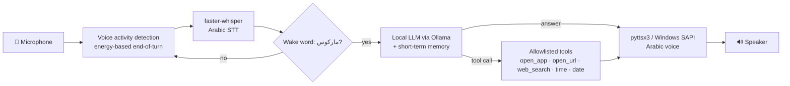

# Marcos — Arabic Voice Assistant (local, offline-first)

> مساعد صوتي عربي يعمل محلياً على جهازك: تكلّمه بالعربي، يفهم، يرد بصوت، وينفّذ مهام بسيطة على Windows بأمان.

Marcos is a voice assistant that runs entirely on a Windows PC: speech recognition, the language model and speech synthesis all run locally, so no audio leaves the machine. It is built as a small, testable **voice-agent pipeline** — turn detection, STT, LLM reasoning with tool calls, and TTS — with per-stage latency measurement.

## How it works



1. **Turn detection (VAD).** The recorder calibrates to room noise, waits for speech, keeps a 300 ms pre-roll so the first syllable isn't clipped, and ends the turn after 800 ms of silence — no fixed-length recording.
2. **Speech-to-text.** `faster-whisper` (GPU with automatic CPU fallback), greedy decoding and Whisper's internal VAD for lower latency.
3. **Wake word.** Arabic-aware matching (diacritics and letter variants normalised), and you can speak in one breath: *"ماركوس افتح الحاسبة"*.
4. **Reasoning.** A local model through Ollama (default `deepseek-r1:8b`) with the last few turns as memory. Reasoning blocks (`<think>…</think>`) are stripped before anything is spoken or executed.
5. **Tools, safely.** The model can only request tools from a fixed allowlist with validated arguments. It never produces shell commands, so there is no command-injection surface.
6. **Speech.** pyttsx3 picks an installed Arabic SAPI voice when available.
7. **Latency.** Every turn logs STT / LLM / tool / TTS time to `logs/latency.csv`, and the session median is printed on exit.

## Features

| | |
|---|---|
| 🗣️ Arabic-first | Saudi dialect & MSA input via Whisper; Arabic replies |
| 🔒 Private | Everything runs locally (Whisper + Ollama + SAPI) |
| 🛡️ Safe tool use | Allowlisted tools, argument validation, URL-scheme checks, unknown tools refused |
| ⏱️ Measured | Per-stage latency logging for every turn |
| 🧪 Tested | 25 unit tests for parsing, wake word, tools, VAD end-pointing, memory, metrics |

## Quick start

Requirements: Windows 10/11, Python 3.10+, a microphone, [Ollama](https://ollama.com). An NVIDIA GPU is optional (CPU works, slower).

```bash
ollama pull deepseek-r1:8b
python -m venv venv
venv\Scripts\activate
pip install -r requirements.txt
python agent.py
```

Say **"ماركوس"** and then your request, for example:

| You say | Marcos does |
|---|---|
| ماركوس افتح الحاسبة | Opens Calculator |
| ماركوس ابحث عن طقس الرياض | Opens a web search |
| ماركوس كم الساعة؟ | Tells the time |
| ماركوس وش عاصمة اليابان؟ | Answers from the model |

For a better voice, install an Arabic speech pack: *Settings → Time & language → Speech → Add voices → Arabic*.

## Configuration

Everything tunable is in [`config.py`](config.py): model names, wake-word spellings, VAD thresholds and silence timing, TTS rate, and the app allowlist.

## Project structure

```text
agent.py            # entry point: the turn loop
config.py           # all settings
marcos/
  audio.py          # microphone capture + EndpointDetector (VAD)
  stt.py            # faster-whisper wrapper with GPU→CPU fallback
  llm.py            # Ollama client, system prompt, conversation memory
  text.py           # Arabic normalisation, wake word, reply/tool parsing
  tools.py          # allowlisted tools with validation
  tts.py            # pyttsx3 speaker with Arabic voice selection
  metrics.py        # per-stage latency timing and CSV log
tests/              # unit tests (no microphone or GPU needed)
```

## Tests

```bash
python -m unittest discover -s tests -t .
```

## Roadmap

- Streaming STT and streaming TTS to start speaking before the full reply is generated
- Barge-in: stop speaking when the user interrupts
- Neural Arabic TTS voice
- Swap the energy VAD for Silero VAD in noisy rooms
- Native tool calling with a model that supports it

## Author

**Abdulmohsen Aljomah** — AI Engineer (Applied AI, LLMs, RAG) · [LinkedIn](https://www.linkedin.com/in/abdulmohsen-aljomah-1398203a8)
